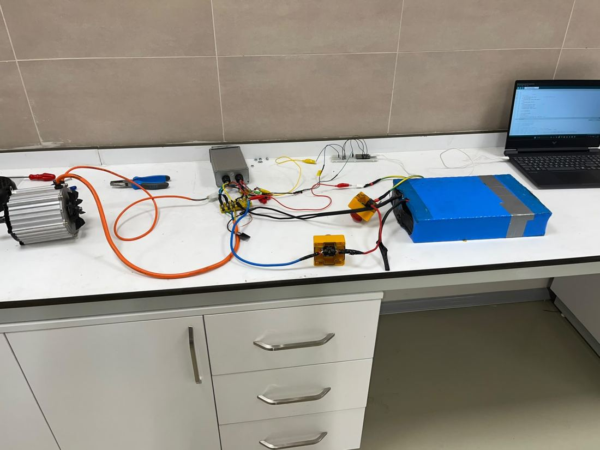

# BLDC motor ile arka aks hız kontrolü

TEKNOFEST aracının arka aksındaki iki tekerleğin dönüşünü, 2 kW'lık BLDC motor ve YUYANG KING sürücü üzerinden bir ESP32 ile kontrol eden ders projesi. Hedef, mikrodenetleyicide kapalı çevrim (PD/PI) hız kontrolü; istenirse tekerlek açısı kontrolü.



*Solda motor, ortada sürücü ve sarı klemens bloğu, breadboard üstünde ESP32, sağda 17S Li-ion batarya.*

## Şu anki durum (20 Kasım 2026)

| Konu | Durum |
|---|---|
| Gaz | ESP32 GPIO25 DAC çıkışından analog gerilim. Tekerler havadayken kalkış ≈ 1,60 V |
| Yön | Gri tel. 0 V'a çekilince geri. Doğrulandı |
| Fren | Fren teli bulundu, GPIO27'ye bağlanıyor. Kodda var, tezgâhta henüz denenmedi |
| Enkoder | MT6701 (I²C) motorun arka mil ucunda. Kodda var, masa testi bekleniyor |
| Kapalı çevrim | Henüz yok. Şu anki yazılım açık çevrim test programı |
| Dişli oranı | N ≈ 9 ya da 4,5. Kesin ölçüm bekleniyor |

Ayrıntılar: [docs/tezgah-ozeti.md](docs/tezgah-ozeti.md)

## Donanım

| Parça | Model |
|---|---|
| Motor | XH60, 72 V, 2000 W BLDC, Hall sensörlü |
| Sürücü | YUYANG KING YKZ serisi (24–144 V, Hall gaz 0,8–3,6 V) |
| Batarya | 17S Li-ion, ölçülen 63,7 V (tam dolu 71,4 V) |
| Mikrodenetleyici | ESP32 (WROOM-32) geliştirme kartı |
| Enkoder | MT6701 manyetik açı sensörü modülü, 14 bit, I²C (pinler: VDD, GND, Analog/PWM, SCL, SDA) |
| Güç tarafı | 100 Ω 5 W ön şarj direnci, acil stop, 6'lı klemens bloğu |

## ESP32 bağlantıları

Transistör kullanılmıyor. Yön ve fren pinleri "open-drain" modunda: teli ya 0 V'a çekiyor ya da bırakıyor, hiçbir zaman 3,3 V vermiyor.

| ESP32 | Ara eleman | Nereye | Görev |
|---|---|---|---|
| GND | doğrudan | Gaz fişi **siyah** (B−) | Ortak toprak, tek bağlantı noktası |
| GPIO25 | 1 kΩ | Gaz fişi **yeşil** | Gaz gerilimi (DAC) |
| GPIO26 | 1 kΩ | Yön fişi **gri** | 0 V = geri, boşta = ileri |
| GPIO27 | 1 kΩ | **Fren** teli | 0 V = fren, boşta = fren yok |
| GPIO33 | doğrudan (gerekirse + 4,7 kΩ pull-up 3V3'e) | MT6701 **SDA** | Enkoder I²C |
| GPIO32 | doğrudan (gerekirse + 4,7 kΩ pull-up 3V3'e) | MT6701 **SCL** | Enkoder I²C |
| 3V3 | doğrudan | MT6701 **VDD** | Enkoder beslemesi (5 V değil) |
| GND | doğrudan | MT6701 **GND** | |
| — | — | MT6701 **Analog/PWM** | Boş |
| — | — | Gaz fişi **kırmızı** (5 V), kilit teli | **ESP32'ye bağlanmaz** |

Ayrıntılı açıklama ve nedenleri: [docs/baglantilar.md](docs/baglantilar.md)

## Yazılım

`firmware/ESP32_ArkaAks_Gaz_Yon_Fren_Enkoder/` klasörünü Arduino IDE ile açın. Kart: **ESP32 Dev Module**. Seri Port Ekranı: **115200 baud**, satır sonu **Yeni Satır**.

12 saniyelik çalışma penceresi: 0–2 s gaz 0 (yön burada değişir) → 2–5 s gaz (0,3 s rampa) → 5–12 s gaz 0. Yön değişimi açıksa pencereler A (ileri) ve B (geri) sırayla gelir. Açılışta motor durur, yön ileri, fren yok.

| Komut | İş |
|---|---|
| `g` / BOOT düğmesi | Başlat / durdur |
| `s` / boşluk | Acil durdurma: gaz 0, fren devrede, yön ileri |
| `+` / `-` | Gazı 0,05 V artır / azalt (üst sınır 1,70 V) |
| `y` | Yön değişimini aç / kapat (yalnızca dururken) |
| `f` | Freni aç / kapat (fren devredeyken gaz hep 0) |
| `m` | Enkoder izleme (dururken 200 ms'de bir satır) |
| `e` | Enkoder durumu |
| `i` | I²C teşhisi: hat seviyeleri, adres taraması, SDA/SCL ters mi |
| `c` | Ekran: okunur ↔ CSV (Excel için) |
| `r` | Tur sayaçlarını sıfırla |
| `n9`, `n4.5` | Dişli oranını ayarla (motor turu / teker turu) |
| `?` | Genel durum |

Çalışırken ve `m` izlemesinde her 200 ms'de bir satır basılır. Varsayılan okunur ekran:

```
MOTOR aci  123.4°  tur   +1.343 | TEKER aci   53.7°  toplam     +53.7° | devir    0.0 d/dk | hata 0
```

`c` ile Excel'e aktarılabilir CSV'ye geçilir (ayraç `;`):

```
t_ms;pencere;yon;fren;gaz_V;motor_ddk;teker_ddk;teker_derece;motor_tur;okuma_hata
```

`teker_derece`, motor açısının dişli oranına bölünmüş halidir. Açık diferansiyel yüzünden iki tekerleğin ortalamasını verir.

## Güvenlik

- Bağlantılar enerji yokken değiştirilir.
- ESP32'nin GND'si sürücüye yalnızca gaz fişinin siyahından bağlanır. Dizüstü bilgisayar şarja takılı değilken çalışılır.
- Gaz fişinin kırmızı (5 V) teli ve kilit teli ESP32'ye bağlanmaz. ESP32 pinleri en fazla 3,6 V kaldırır.
- GPIO26 ve GPIO27'deki 1 kΩ dirençler çıkarılmaz: boştaki 5 V'luk hatlar pini korumasız bırakır.
- Sarı self-learning kablo çifti kısa devre edilmez.
- Dönen tekerlere elle yük verilmez. Kaldırılan araç kriko değil sehpa üstünde durur.
- Batarya yalnızca 17S Li-ion için 71,4 V CC/CV şarj aletiyle şarj edilir. Kıvılcım çıkaran eski paket kullanılmaz.
- Bugünkü düzende acil stop basılıyken de sistem ön şarj direnci üzerinden canlıdır; iş bitince batarya ayrılır.

Tam liste: [docs/tezgah-ozeti.md#10-güvenlik-kuralları](docs/tezgah-ozeti.md#10-güvenlik-kuralları)

## Sıradaki adımlar

1. Ana hatta sigorta; acil stopu kilit hattına taşımak.
2. MT6701 masa testi: açı 0→360° kesintisiz, okuma hatası yok.
3. Enkoderi ara parçayla fan kapağına monte etmek, hava boşluğunu hamurla doğrulamak.
4. Dişli oranını enkoderle 5 turda ölçmek.
5. Fren telini tezgâhta denemek.
6. Gaz–hız eğrisini iki yön için çıkarmak; yerde, yük altında kalkış eşiğini ölçmek.
7. Ölü bölge telafili PD/PI hız kontrolü; sonra istenirse açı kontrolü.

## Klasörler

```
├── README.md
├── docs/
│   ├── tezgah-ozeti.md     Tezgâh çalışmasının ayrıntılı özeti (11–20 Kasım 2026)
│   ├── baglantilar.md      ESP32, sürücü ve enkoder bağlantıları, nedenleriyle
│   ├── pdf/                Tezgâh özetinin PDF hali
│   └── img/                Tezgâh fotoğrafları
└── firmware/
    └── ESP32_ArkaAks_Gaz_Yon_Fren_Enkoder/   Güncel ESP32 programı
```

## Kaynaklar

- YUYANG KING YKZ serisi BLDC sürücü kullanım kılavuzu (üretici: Taizhou Luqiao DXYG Electric). Kılavuzdaki kablo renkleri bu ürünle her yerde uyuşmuyor; renklere değil ölçüme güvenin.
- MagnTek MT6701 veri sayfası, Rev 1.8 (2022.12)
