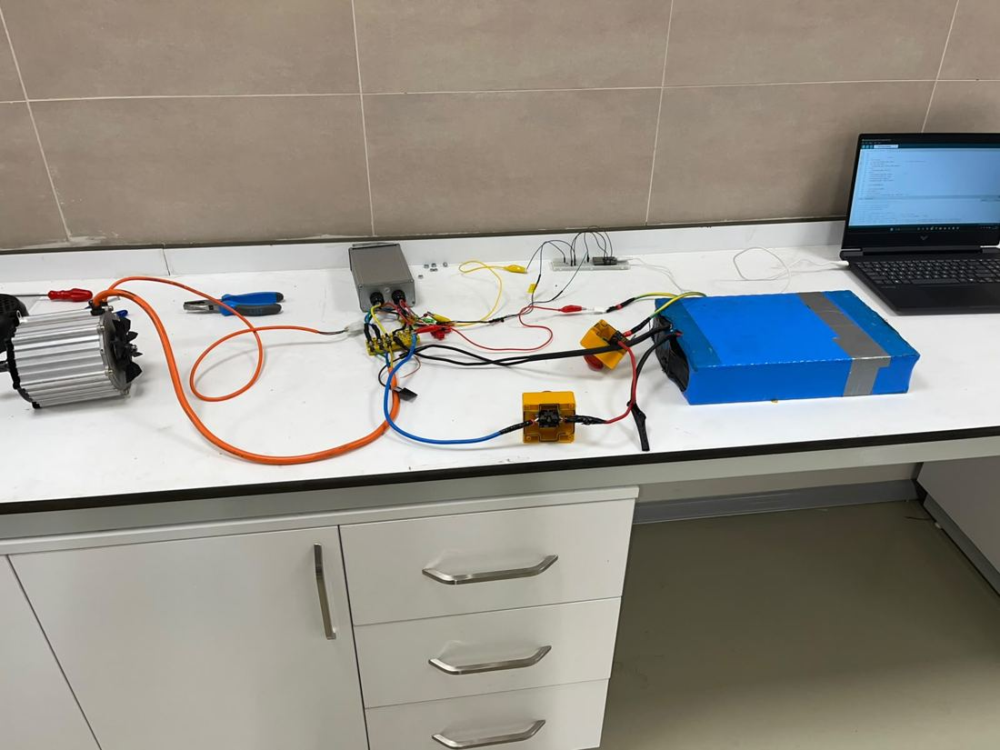
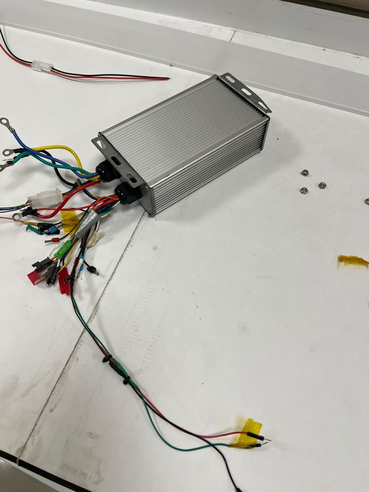
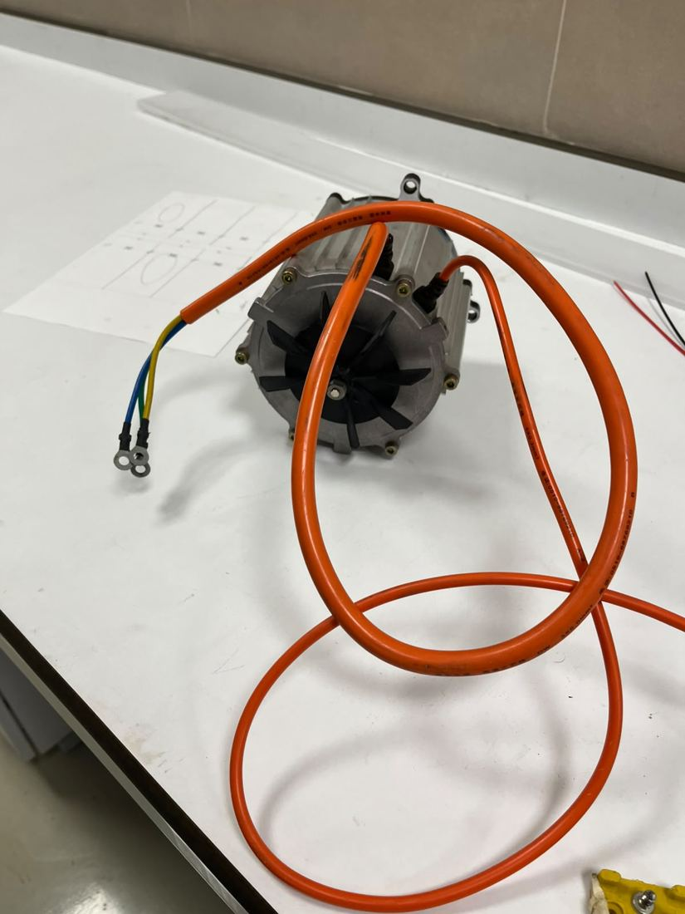
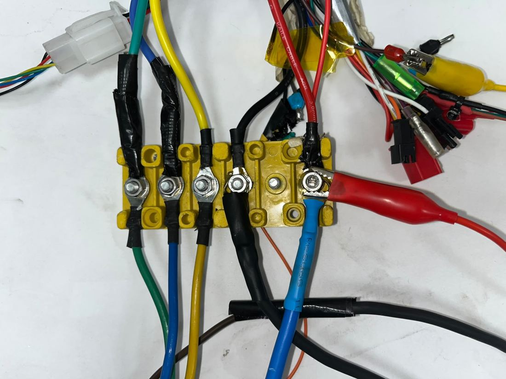
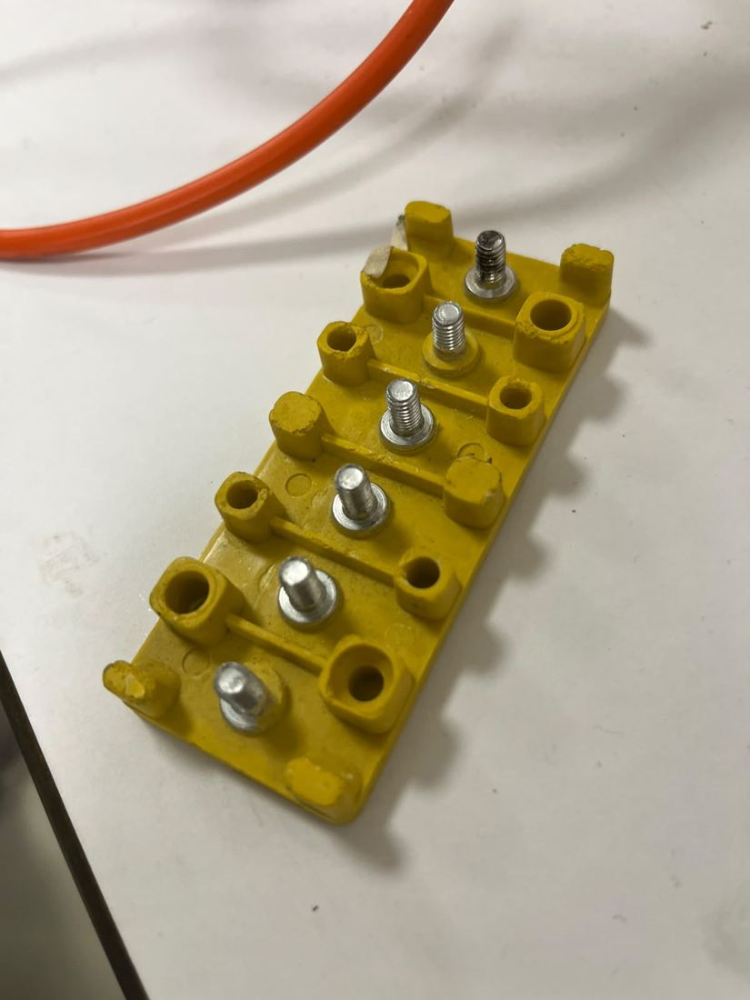
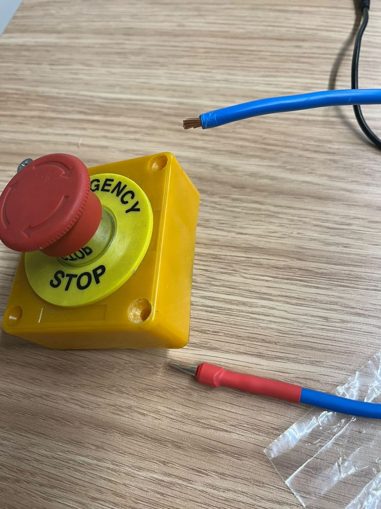
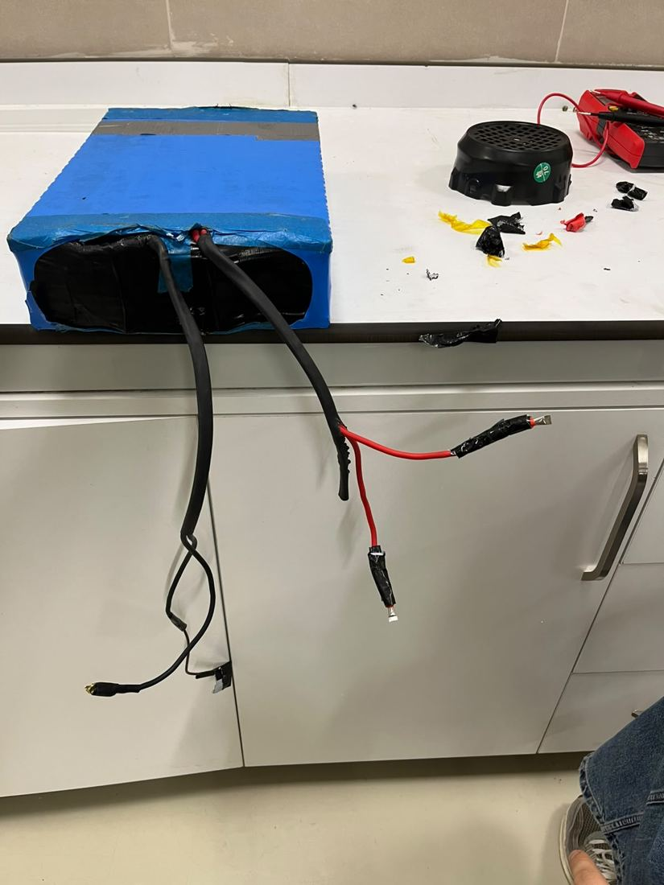
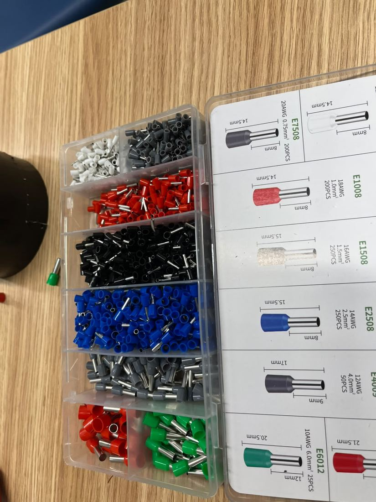

# Arka aks hız kontrolü: tezgâh çalışması özeti

11–20 Kasım 2026 · ESP32 + YUYANG KING BLDC sürücü + 2 kW motor

PDF hali: [pdf/Arka_Aks_Tezgah_Ozeti.pdf](pdf/Arka_Aks_Tezgah_Ozeti.pdf)

> **20 Kasım güncellemesi (PDF'ten sonra):**
> - BC547 transistörler kullanılmıyor. Yön (GPIO26) ve fren (GPIO27) pinleri 1 kΩ üzerinden doğrudan, open-drain modunda bağlanıyor. Bkz. [baglantilar.md](baglantilar.md).
> - Fren teli bulundu; GPIO27'ye bağlanıyor, kodda `f` komutu ve acil durdurmada kullanılıyor. Tezgâhta henüz denenmedi.
> - Enkoder okuması ve canlı tekerlek açısı ana programa eklendi. Kullanılan MT6701 modülünde yalnızca VDD, GND, Analog/PWM, SCL, SDA pinleri var; enkoder SSI yerine **I²C** ile okunuyor (SDA → GPIO33, SCL → GPIO32).
> - MT6701 değerleri veri sayfasının Rev 1.8 sürümüne göre güncellendi.

İşaretler: ✅ ölçülerek doğrulandı · ⚠️ emin değiliz / ölçülecek · 🛑 güvenlik uyarısı

## İçindekiler

1. [Projenin bugünkü hali](#1-projenin-bugünkü-hali)
2. [Donanım listesi](#2-donanım-listesi)
3. [Güç tarafı: batarya, ön şarj direnci, acil stop, klemens](#3-güç-tarafı-batarya-ön-şarj-direnci-acil-stop-klemens)
4. [Sürücünün sinyal kabloları](#4-sürücünün-sinyal-kabloları)
5. [ESP32 – sürücü bağlantıları](#5-esp32--sürücü-bağlantıları)
6. [Gaz sinyali: neden PWM değil DAC](#6-gaz-sinyali-neden-pwm-değil-dac)
7. [Yazılım](#7-yazılım)
8. [Deney sonuçları ve dişli oranı](#8-deney-sonuçları-ve-dişli-oranı)
9. [MT6701 enkoder](#9-mt6701-enkoder)
10. [Güvenlik kuralları](#10-güvenlik-kuralları)
11. [Açık kalanlar ve sıradaki adımlar](#11-açık-kalanlar-ve-sıradaki-adımlar)

## 1. Projenin bugünkü hali

Proje, ders projesi olarak "uçak kanadındaki flapların açı kontrolü" diye başladı: mikrodenetleyicide çalışan PD kontrolcü ve sensör geri beslemesiyle kapalı çevrim kontrol. Flap'i taklit eden bir mekanizmayı sıfırdan yapmak çok emek istediği için kontrol edilen sistem değişti: artık TEKNOFEST aracının arka aksı ve iki arka tekerleği kontrol ediliyor.

- **Değişmeyen:** mikrodenetleyicide kapalı çevrim kontrol, ESP32 (ileride STM32 ile), BLDC motor, sensör geri beslemesi.
- **Değişen:** kontrol edilen büyüklük flap açısından tekerleğin dönüşüne (hız, istenirse açı) geçti.
- **Neden daha gerçekçi:** 2 kW'lık motor, aracın ağırlığı, dişli ve diferansiyel sürtünmesi gerçek bir yük oluşturuyor.



## 2. Donanım listesi

| Parça | Özellik | Not |
|---|---|---|
| Motor | XH60, 72 V, 2000 W BLDC, Hall sensörlü | Arka uçta fan ve fan kapağı var; enkoder buraya takılıyor |
| Sürücü | YUYANG KING serisi BLDC sürücü | Kılavuza göre 24–144 V, Hall gaz girişi 0,8–3,6 V, kilit girişi ≤ 200 mA |
| Batarya | 17S Li-ion | Ölçülen 63,7 V (hücre başına 3,75 V, yaklaşık yarı dolu); tam dolu 71,4 V |
| Mikrodenetleyici | ESP32 geliştirme kartı | Dizüstünden USB ile beslenir |
| Dirençler | 1 kΩ (seri koruma), 100 Ω 5 W taş direnç (ön şarj) | |
| Enkoder | MT6701 manyetik açı sensörü, 14 bit | Diametrik mıknatıs motor mil ucunda |
| Acil stop | Mantar başlı, sarı kutulu | Bkz. bölüm 3 |
| Yüksük seti | 0,75–6 mm² kablo yüksükleri | Çok telli kablo uçları vidalı klemense yüksükle bağlanır |

| | |
|---|---|
|  |  |
| YUYANG sürücü ve kablo demeti | Motor: üç faz kablosu turuncu kılıfta; arkada fan |

## 3. Güç tarafı: batarya, ön şarj direnci, acil stop, klemens

### 3.1 Klemens bloğu

Tüm kalın kablolar sarı, 6 vidalı klemens bloğunda birleşiyor.

| Vida (soldan) | Bağlı olan |
|---|---|
| 1, 2, 3 | Fazlar: sürücünün yeşil, mavi, sarı faz çıkışları ↔ motorun yeşil, mavi, sarı faz kabloları |
| 4 | B−: sürücünün siyah − kablosu ve bataryanın − kablosu |
| 5 | Boş |
| 6 | B+: sürücünün kırmızı + kablosu ve acil stoptan gelen mavi kalın kablo; ön şarj direncinin timsahı da burada |

| | |
|---|---|
|  |  |
| Bağlı hali. Sağdaki vidada kırmızı timsah ön şarj direncine gider | Boş hali. Pabuçlar vidaya takılıp üstüne somun sıkılır |

### 3.2 Ön şarj (yol verme) direnci neden gerekli

Sürücünün girişinde büyük kondansatörler var. Boşken, bağlandığı anda neredeyse kısa devre gibi davranırlar. Batarya doğrudan bağlanınca ilk anda yüzlerce amperlik kısa bir akım darbesi akar; ilk denemelerdeki kıvılcımın sebebi buydu. Bu darbe zamanla konnektör yüzeylerini yakar, sigortayı da attırabilir.

Araya 100 Ω girince ilk akım sınırlanır:

- İlk akım: 63,7 V / 100 Ω ≈ 0,64 A
- İlk anki güç: 63,7² / 100 ≈ 40 W. Çok kısa sürdüğü için 5 W'lık taş direnç bunu kaldırır.
- Birkaç saniye içinde kondansatör bataryanın gerilimine yaklaşır; sonra ana kontak kapanınca kıvılcım çıkmaz.

✅ Ön şarj direnciyle bağlantıda kıvılcım çıkmadı.

### 3.3 Acil stop ile otomatik ön şarj (bugünkü düzen)

Bataryanın + ucu acil stopun kontağından geçerek klemensin B+ vidasına gidiyor; 100 Ω taş direnç timsahlarla acil stop kontağına paralel bağlı.

```
Batarya + ──[sigorta: henüz yok]──┬──[acil stop kontağı]──┬── B+ vidası → sürücü kırmızı +
                                  └──[100 Ω 5 W]──────────┘
Batarya − ─────────────────────────────────────────────────── B− vidası → sürücü siyah −
```

1. Acil stop basılıyken (kontak açık): akım yalnızca 100 Ω üzerinden akar, kondansatörler yavaşça dolar; motora anlamlı bir güç gidemez (en fazla 0,64 A).
2. Birkaç saniye bekleyip acil stop bırakılınca kontak direnci kısa devre eder; kondansatör dolu olduğu için kıvılcım çıkmaz.
3. Yani ön şarj, acil stopun sırasıyla kendiliğinden yapılır.

⚠️ Bu bölüm fotoğraflardan çıkarıldı. Bağlantı farklıysa düzeltilmeli.

🛑 **Bu düzenin üç zayıf noktası**

1. **Acil stop basılıyken sistem ölü değil.** Batarya 100 Ω üzerinden sürücüye bağlı kalır. Kilit girişi en fazla 0,2 A çeker: 100 Ω'da 20 V düşer, direnç 4 W ısınır; 5 W'lık direnç için sınıra yakın. Acil stop uzun süre basılı bırakılmamalı, iş bitince batarya ayrılmalı.
2. **Acil stop kontakları DC akım kesmeye uygun olmayabilir.** Kontaklarda genelde AC değer yazar; 60–70 V DC'de kesebildikleri akım çok daha düşüktür, çünkü DC'de ark kendiliğinden sönmez. Tezgâhta düşük gazda akım birkaç amper olduğu için sorun çıkmadı; araç yük altındayken kontak yanabilir ya da yapışabilir.
3. **Hâlâ sigorta yok.** Bir kısa devrede bataryayı hiçbir şey korumuyor.

**Kalıcı çözüm önerisi:** Ana hatta batarya + → sigorta yuvası (ör. 10×38 mm, DC'ye uygun 16 A gPV sigorta; kapağı ana anahtar olarak da kullanılır) → B+ vidası. Ön şarj direnci sigorta yuvasının üstünden yapılır. Acil stop kilit hattına konur: B+ → 1 A sigorta → kilit anahtarı → acil stop (normalde kapalı) → sürücünün kilit teli. Kilit teli en fazla 0,2 A çektiği için acil stop kontağı rahat çalışır; basıldığında sürücü kapanır ve motor durur.

| | | |
|---|---|---|
|  |  |  |
| Acil stop kutusu; mavi kablonun ucunda yüksük ve makaron | 17S paket; + ucu ikiye ayrılmış, uçlar bantlı | Çok telli kablo klemense çıplak sokulmaz, yüksük sıkılır |

## 4. Sürücünün sinyal kabloları

Sürücünün kılavuzu kablo renkleri konusunda bu ürünle uyuşmadığı için tüm kablolar ESP32 bağlı değilken multimetreyle ölçüldü (siyah prob B−'de).

| Soket / kablo | Boştayken | Görevi | Durum |
|---|---|---|---|
| Gaz · kırmızı | 5,05 V | Sürücünün 5 V beslemesi | Boş ve bantlı. ESP32'ye asla bağlanmaz |
| Gaz · yeşil | 0 V | Gaz sinyali (Hall gaz: 0,8–3,6 V) | ✅ GPIO25 → 1 kΩ → yeşil |
| Gaz · siyah | 0 V | B− (toprak) | ESP32 GND'nin tek bağlantı noktası |
| Yön · gri | 4,7 V | Geri yön: 0 V'a çekilince motor ters döner | ✅ 11 ve 16 Kasım |
| Yön · bronz | 5,05 V, iç pull-up ≈ 10,2 kΩ | Belirsiz: toprağa çekilince yön değişmedi, hız biraz değişti | ⚠️ Bkz. 4.2 |
| Yön · siyah | 0 V | B− | |
| Fren | ölçülecek | 0 V'a çekilince fren (varsayım) | ⚠️ Bulundu, tezgâhta denenmedi |

Bronzun iç direnci: 1 kΩ ile toprağa bağlanınca 0,452 V çıktı → (5,05 − 0,452) / (0,452 / 1000) ≈ 10,2 kΩ.

### 4.1 Yön değişimi

- Gri boşta (4,7 V) → ileri. Gri 0 V'a çekilince → geri.
- Yön değişimi motor dururken yapılır: yazılım önce gazı 0'a indirir, yön pinini değiştirir, sonra yeniden gaz verir.
- Kılavuza göre sürücüde "güvenli geri" var: geri hız ileri hızın %30–50'siyle sınırlanabiliyor; düşük gazda fark edilmez.

⚠️ **Gözlem: geri yön biraz daha hızlı.** İki olası sebep: (1) Hall sensörleri bir yöne birkaç derece kaymış olabilir; bu durumda fark her gazda kabaca sabit bir oran olur. (2) Dişli/diferansiyel sürtünmesi yöne göre farklı olabilir; kalkış eşiğine yakın gazda küçük sürtünme farkı büyük hız farkı yaratır. Ayırmak için 1,60 / 1,65 / 1,70 V'ta iki yönde hız enkoderle ölçülüp geri/ileri oranına bakılacak.

### 4.2 Bronz kablo

Kılavuz bu 3'lü sokete "Neutral reversing" diyor: bronz = geri, gri = boş, siyah = toprak. Ölçümler tersini gösterdi: gri geri yaptı. GPIO26 yanlışlıkla bronza bağlandığında motor yön değiştirmedi, yalnızca hızı biraz değişti. Bronz bir hız modu ya da kısmi "boş" girişi olabilir. ⚠️ Ayırma deneyi:

1. Bronz toprakta, motor dururken gaz ver: hiç dönmüyorsa "boş" girişidir.
2. Sabit gazda bronzu toprağa çekip bırak: hız belirli bir değere inip sabit kalıyorsa hız modudur.
3. 1,70 V'ta tekrarla: hız modu ise fark yüksek gazda büyür.

### 4.3 Fren girişleri

Kılavuza göre iki fren girişi var. Renkler yön soketindeki gibi kılavuzdan farklı olabilir.

| Giriş | Kılavuzdaki renk | Beklenen davranış (kılavuza göre) |
|---|---|---|
| Düşük seviye fren (Low-V brake) | Gri, ayrı 3'lü sokette; yanında siyah | Toprağa çekilince gazı keser; seçenekli olarak elektronik frenleme (EABS) |
| Yüksek seviye fren (High-V brake) | Mor, 2'li soket | Gerilim uygulanınca gazı keser |

Fren teli bulundu ve GPIO27'ye bağlanıyor. Kod düşük seviye fren davranışını varsayar. Bir buton aynı hattı toprağa çekerse yazılımdan bağımsız bir donanım durdurması da olur.

### 4.4 Dokunulmayacak kablolar

- 🛑 Sarı "self-learning" çifti: kısa devre edilirse sürücü Hall–faz eşleşmesini yeniden öğrenir; yönler ve bulunan kablo davranışları değişebilir.
- 🛑 Gaz fişinin kırmızı (5 V) teli ve kilit teli: ESP32'ye ya da STM32'ye asla bağlanmaz.

## 5. ESP32 – sürücü bağlantıları

Güncel tablo ve nedenleri: [baglantilar.md](baglantilar.md).

> PDF'teki BC547'li yön devresi artık kullanılmıyor. Yön ve fren pinleri 1 kΩ üzerinden doğrudan bağlı ve open-drain modunda çalışıyor.

✅ GPIO25 ile GPIO26 bir kez yanlışlıkla yer değiştirdi; GPIO26 bir kez bronza bağlandı. ESP32 zarar görmedi.

## 6. Gaz sinyali: neden PWM değil DAC

Sürücünün gaz girişi analog bir gerilim bekliyor: normalde gaz kolundaki Hall sensörü 0,8–3,6 V arası bir gerilim verir.

- **PWM:** pin çok hızlı açılıp kapanır, 0 V ile 3,3 V arasında kare dalga üretir. Sürücü ortalamayı değil anlık değeri okuyabilir; araya RC filtre gerekir.
- **DAC:** ESP32'nin GPIO25 ve GPIO26 pinlerinde gerçek analog çıkış var; filtre gerekmez. 8 bit: 3,3 V / 255 ≈ 13 mV adım.

Gaz için GPIO25'in DAC çıkışı kullanılıyor (`dacWrite(25, değer)`). Yazılımdaki "gaz 1,60 V" DAC'a yazılan değerdir; yeşil telde 1 kΩ yüzünden biraz daha düşük ölçülür.

| Durum | DAC | Sonuç |
|---|---|---|
| Motor tek başına (11 Kasım) | 1,40 V | Dönüyor (yeşilde ≈ 1,2 V). Bir kez dönmedi: eşiğin sınırında |
| Motor aksta, tekerler havada (16 Kasım) | 1,50 V | Yalnızca küçük kıpırdama |
| Motor aksta, tekerler havada (16 Kasım) | 1,60 V | Dönüyor; ileri–geri yön değişimi sorunsuz |
| Yazılımdaki üst sınır | 1,70 V | `GAZ_UST_SINIR_V` |

⚠️ **Dar pay:** kalkış 1,60 V, üst sınır 1,70 V; kontrol için yalnızca 0,10 V pay var. Tekerler yere basınca kalkış eşiği yükselecek. Üst sınır yerdeki ölçümden sonra 0,05 V adımlarla yükseltilecek.

## 7. Yazılım

Tek bir Arduino programı gaz, yön, fren ve enkoder okumasını birlikte yapar: [firmware/ESP32_ArkaAks_Gaz_Yon_Fren_Enkoder](../firmware/ESP32_ArkaAks_Gaz_Yon_Fren_Enkoder). Seri port 115200 baud, satır sonu "Yeni Satır". Komut listesi: [README](../README.md#yazılım).

Çalışma döngüsü (12 s pencere): 0–2 s gaz 0 (yön burada değişir) → 2–5 s gaz, 0,3 s rampa → 5–12 s gaz 0. Yön değişimi açıksa pencereler A (ileri) ve B (geri) sırayla değişir; B penceresinde kart LED'i yanar. Açılışta motor durur, yön ileri, fren yok.

Çalışırken her 200 ms'de bir satır basılır: varsayılan olarak motor ve teker açısı, devir ve okuma hatası okunur biçimde; `c` komutuyla Excel'e aktarılabilir CSV biçiminde (`t_ms;pencere;yon;fren;gaz_V;motor_ddk;teker_ddk;teker_derece;motor_tur;okuma_hata`).

**Yükleme hatası:** "0x13" ya da "Connecting…" hatasında BOOT düğmesini basılı tutup "Connecting" sırasında EN'e bir kez basın.

## 8. Deney sonuçları ve dişli oranı

| Tarih | Deney | Sonuç |
|---|---|---|
| 11 Kasım | Motor tek başına, ESP32'den gaz | İlk dönüş, 1,40 V'ta |
| 11 Kasım | Bronz toprağa | Yön değişmedi |
| 11 Kasım | Gri toprağa | Motor ters döndü: gri = geri |
| Kasım | Ön şarj direnciyle bağlantı | Kıvılcım yok |
| 16 Kasım | Motor aksta, teker elle 1 tur | Motor mili 4,5 tur |
| 16 Kasım | Gaz 1,50 / 1,60 V | 1,50 V kıpırdama; 1,60 V dönüyor, yön değişimi sorunsuz |
| 16 Kasım | GPIO26 yanlışlıkla bronza | Yön yerine hız biraz değişti |
| 16 Kasım | Gri ile ileri–geri | Geri yön biraz daha hızlı |

### 8.1 Dişli oranı

Arka aks açık diferansiyelli; motorun gördüğü dönüş iki tekerin ortalamasıdır. 4,5 tur iki şekilde okunabilir:

- Diğer teker sabit/yerdeydiyse: bir teker 1 tur, diğeri 0 → ortalama 0,5 tur. Motor 4,5 tur → **N ≈ 9**.
- İki teker birlikte döndüyse: **N ≈ 4,5**.

Hız karşılaştırması (motor devri 3000 d/dk varsayımıyla, doğrulanmadı; 185/55R14 lastik, çevre 1,757 m):

| N | Teker devri | Araç hızı |
|---|---|---|
| 4,5 | 667 d/dk | ≈ 70 km/sa |
| 9 | 333 d/dk | ≈ 35 km/sa |
| 20 | 150 d/dk | ≈ 16 km/sa |

Hesap: teker devri = 3000 / N; hız = teker devri × 1,757 m × 60 / 1000.

**Kesinleştirme ölçümü:** Tekerler yerden kaldırılır, iki teker aynı yönde ve birlikte 5 tur çevrilir. Enkoderle: `r` ile sıfırla, 5 tur çevir, `e` ile motor turunu oku; N = motor turu / 5. Sonra programda `n` komutuyla ayarlanır (ör. `n9`). Varsayılan: N = 9.

## 9. MT6701 enkoder

MT6701, üstünde dönen bir mıknatısın alan yönünü okuyarak açıyı veren bir sensör. Tur başına 16384 adım (14 bit). Modül I²C ile okunuyor. Bağlantı ayrıntıları: [baglantilar.md](baglantilar.md#2-esp32--mt6701-enkoder-i2c).

### 9.1 Veri sayfasındaki sınırlar (Rev 1.8)

| Büyüklük | Değer |
|---|---|
| Önerilen mıknatıs | Ø6 × 2,5 mm, diametrik (kutupları yan yüzde) |
| Hava boşluğu (mıknatıs – çip yüzeyi) | 0,5–2,0 mm, tipik 1,0 mm |
| Çip yüzeyinde alan | 200–1000 gauss |
| Eksen kaçıklığı | en fazla 0,3 mm |
| Besleme | 3,0–5,5 V (projede 3,3 V) |

PDF'teki değerler eski Rev 0.1 sürümünden alınmıştı (Ø8 × 2,5 mm, 300–800 gauss).

### 9.2 Montaj hesabı

Mıknatıs fanın ortasındaki mil ucuna takıldı: mil ucu rotorla 1:1 döner ve eksenin tam üstündedir. Ölçümler:

- Kapağın dış yüzünden mıknatısa: 10,6 mm
- Kapak kalınlığı: 2,0 mm
- Kart + çip birlikte: 3,1 mm (kart 1,4 mm, çip 1,7 mm)

Kart kapağın iç yüzüne doğrudan yapışırsa boşluk = 10,6 − 2,0 − 3,1 = 5,5 mm, sınırın çok üstünde. Kart iç yüzden içeri doğru bir ara parçayla sarkıtılmalı:

| Hedef boşluk | Ara parça |
|---|---|
| 1,0 mm (veri sayfası tipik) | 4,5 mm |
| 1,5 mm | 4,0 mm (hazır 4 mm naylon ara parça) |
| 2,0 mm (sınır) | 3,5 mm |

- Kapağın içindeki plastik çıkıntılardan 3,5 mm'den kısa olanlara dokunulmaz; yüksek olanlar 3,5 mm'ye indirilir.
- Montajdan sonra gerçek boşluk oyun hamuruyla ölçülür: mıknatısa nohut kadar hamur konur, kapak takılıp çıkarılır, ezilen hamurun en ince yeri kumpasla ölçülür.
- Mıknatıs şu an yalnızca manyetik çekimle duruyor; testler bitince epoksiyle yapıştırılmalı, sonra 10,6 mm yeniden ölçülür.
- Kart mıknatısa yaklaştığında fan kanatlarına çarpmamalı: plastik cetvel mıknatısın üstüne yatırılıp mil çevrilerek kontrol edilir.
- ⚠️ Mıknatıs çelik mile doğrudan oturduğu için alan zayıflayabilir. I²C'de alan durumu okunamıyor; mil elle çevrilip açının 0–360° düzgün değiştiği `m` komutuyla kontrol edilir.

### 9.3 Lehim notu

Pin başlığı ilk seferde ters tarafa lehimlendi. Lehim emme işi tek bakır telle olmaz; ince telli emme şeridi ve flux gerekir. Havya şerit üstünde 2–3 s tutulur, şerit ve havya birlikte kaldırılır. Pad'i korumak için bir noktaya 3–4 saniyeden uzun ısı verilmez. Final montajda pin başlığı yerine kartın arkasından çıkan ince esnek kablolar kullanılacak.

## 10. Güvenlik kuralları

| Kural | Neden |
|---|---|
| Bağlantılar enerji yokken değiştirilir | Canlı devrede kısa devre ve kıvılcım |
| ESP32 GND yalnızca gaz soketi siyahına | Toprak döngüsü olmasın |
| Dizüstü şarja takılı değilken çalışılır; HDMI vb. bağlı olmaz | Prizin toprağı üzerinden ikinci bir toprak yolu oluşmasın |
| Kırmızı 5 V ve kilit teli ESP32/STM32'ye bağlanmaz | Pinler 5 V'a ve 72 V'a dayanıklı değil |
| GPIO26 ve GPIO27'deki 1 kΩ çıkarılmaz | Boştaki 5 V'luk hatlar pini korumasız bırakır |
| MT6701 3,3 V ile beslenir | Çıkışları besleme geriliminde; 5 V'ta ESP32 pinine 5 V gelir |
| Sarı self-learning çifti kısa devre edilmez | Hall–faz eşleşmesi değişir |
| Jumper ve breadboard yalnızca sinyal tarafında | Güç hatlarının akımını taşıyamaz |
| Dönen tekerlere elle yük verilmez | 2 kW motor, el ve parmak tehlikesi |
| Kaldırılan araç kriko değil sehpa üstünde durur; ön tekerlere takoz | Kriko kayabilir |
| Şarj: yalnızca 17S Li-ion, 71,4 V CC/CV şarj aleti | "72 V Li-ion" şarj aleti 84 V, "72 V kurşun asit" yaklaşık 88 V verir; ikisi de paketi aşırı şarj eder, yangın riski |
| Kıvılcım çıkaran eski batarya paketi kullanılmaz | BMS'i bilinmiyor, arızalı olabilir |
| Acil stop basılıyken de sistem canlıdır (bugünkü düzende) | Ön şarj direnci üzerinden besleme sürer; iş bitince batarya ayrılır |

## 11. Açık kalanlar ve sıradaki adımlar

**Açık sorular**

- Dişli oranı: N ≈ 9 mu, 4,5 mi? 5 turluk ölçümle kesinleşecek.
- Bronz kablonun görevi (hız modu mu, boş mu).
- Geri yönün daha hızlı olmasının sebebi (Hall zamanlaması mı, sürtünme mi).
- Fren telinin rengi/soketi ve davranışı (düşük seviye mi, yüksek seviye mi).
- Sürücünün düşük gerilim kesme değeri: 17S paket 63,7 V'ta; kesme 60–63 V civarındaysa pay az.
- Bataryanın BMS'i ve doğru şarj aleti.
- Acil stop kontaklarının DC akım değeri.

**Sıradaki adımlar**

1. Sigortayı alıp ana hatta takmak; acil stopu kilit hattına taşımak.
2. MT6701'i masada test etmek: açı 0→360° kesintisiz, okuma hatası yok.
3. Enkoderi ara parçayla kapağa monte etmek; hamurla boşluğu doğrulamak.
4. Dişli oranını 5 turla ölçmek; enkoderle karşılaştırmak.
5. Fren telini tezgâhta denemek.
6. Gaz–hız eğrisini iki yön için çıkarmak (1,60–1,70 V); yerde, yük altında kalkış eşiğini ölçmek.
7. Ölü bölge telafisiyle PD hız kontrolünü yazmak; sonra istenirse açı kontrolü.
